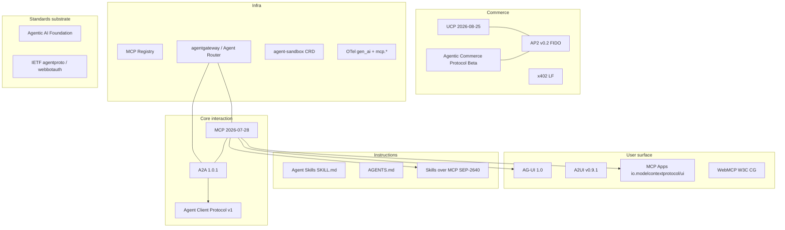

# State of the art, 2026-09-29

The synthesis across every other document in this directory: the layer map, the
per-protocol verdicts, and the scope this library should hold itself to. Every
claim here is expanded in a sibling document, which carries the sources.

- Research date: **2026-09-29**
- Contract: [`../PROTOCOLS.md`](../PROTOCOLS.md) — the normative wire values
- Evidence: [`mcp.md`](mcp.md), [`a2a.md`](a2a.md), [`acp-agent-client.md`](acp-agent-client.md), [`acp-others.md`](acp-others.md), [`ui-protocols.md`](ui-protocols.md), [`instructions.md`](instructions.md), [`commerce.md`](commerce.md), [`orchestration-hitl.md`](orchestration-hitl.md), [`identity-and-discovery.md`](identity-and-discovery.md), [`observability.md`](observability.md), [`runtime-gateway-sandbox.md`](runtime-gateway-sandbox.md), [`platform-support.md`](platform-support.md), [`security.md`](security.md), [`governance.md`](governance.md)

## 0. The acronym problem comes first

Four unrelated protocols are called ACP. Only one is alive and healthy. Any 2026
document using the bare acronym is ambiguous, and the collision is a live
supply-chain hazard for anyone installing a package by name.

| # | Name | Layer | Status |
| --- | --- | --- | --- |
| 1 | Agent **Client** Protocol (Zed, JetBrains) | editor to coding agent | Alive. v1 stable, v2 draft 2026-07-20 |
| 2 | Agent **Communication** Protocol (IBM, BeeAI) | agent to agent | Dead. Merged into A2A 2025-08-25, repo archived 2025-08-27 |
| 3 | **Agentic Commerce Protocol** (OpenAI, Stripe, Meta) | agent to merchant | Beta, spec `2026-04-17` |
| 4 | Agent Control Protocol | agent to app UI | Hobby scale, roughly one star |

The IETF `agentproto` working group is titled "Agent **C**ommunication **P**rotocols",
plural, which is a fifth collision. Full detail in
[`acp-others.md`](acp-others.md).

## 1. The layer map



## 2. Verdicts

| Protocol | Current state | Verdict |
| --- | --- | --- |
| MCP | `2026-07-28`, AAIF, Apache-2.0 | **Ship.** See the adoption caveat below. |
| A2A | `1.0.0` 2026-03-12, patch `v1.0.1` 2026-05-26, AAIF Growth Stage | **Ship** for cross-vendor delegation |
| Agent Client Protocol | v1 stable, v2 draft, Zed and JetBrains | **Ship** for local editor integration |
| Agentic Commerce Protocol | Beta `2026-04-17`, OpenAI/Stripe/Meta | **Watch.** Last repo commit 2026-07-18 |
| IBM Agent Communication Protocol | archived 2025-08-27 | **Dead** |
| Agent Control Protocol | roughly one star | **Ignore** |
| MCP Apps | extension `2026-01-26`, Stable | **Ship** |
| AG-UI | 1.0.0 2026-09-17 | **Ship**, accept the governance risk |
| A2UI | v0.9.1 production, v1.0 Candidate | **Watch** |
| WebMCP | W3C CG draft, Chrome origin trial | **Watch** |
| NLWeb | last human commit 2026-05-11, spec URL fails TLS | **Dead** |
| Agent Skills / SKILL.md | unversioned, 46 clients | **Ship** |
| AGENTS.md | plain Markdown, AAIF project | **Ship** |
| Skills over MCP | SEP-2640 Final 2026-09-13 | **Watch**, no client support yet |
| x402 | LF foundation live 2026-07-14 | **Ship** if crypto micropayments are in scope |
| AP2 | v0.2 2026-04-28, FIDO Alliance | **Watch** |
| UCP | `2026-08-25`, Google and Shopify, ungoverned | **Watch** |
| AGNTCY | LF 2025-07-29, Cisco-dominated | **Watch** |
| ANP | spec 1.2, single organisation | **Watch** |
| Web Bot Auth | IETF WG, document 2026-09-01 | **Ship** |
| IETF `agentproto` | Proposed WG 2026-09-09 | **Watch**, protocol not due until Dec 2027 |
| Open Responses | TC-approved, GB vote | **Ship** if vendor-neutral inference is in scope |
| Gateway layer | no standard exists | **Choose a product** |
| Sandbox layer | no protocol | **Watch** |
| Orchestration | no protocol | **Framework-local**, watch Arazzo |
| llms.txt | v2 2026-08-10 | **Ambient**, low value |

## 3. The three that carry the stack

### MCP

Governance moved to the **Agentic AI Foundation** on 2025-12-09, when Anthropic
donated the protocol. The legal entity is "Model Context Protocol, a Series of LF
Projects, LLC". The technical model is unchanged: two BDFL lead maintainers over a
core-maintainer group, Apache-2.0, no CLA. Full detail in [`mcp.md`](mcp.md).

The `2026-07-28` revision is the largest since launch and it is breaking. The
substantive moves are the deletion of sessions and the `initialize` handshake, the
introduction of Multi Round-Trip Requests in place of every server-initiated
request, mandatory `Mcp-Method` and `Mcp-Name` headers so a gateway can route
without parsing a body, cache hints on list results, and a formal twelve-month
deprecation floor. Roots, Sampling and Logging are deprecated with removal no
earlier than 2027-07-28.

**The adoption gap is the caveat that matters for implementation.** The revision
was two months old on the research date. Verified support: Netlify's own server
advertises it with Claude.ai and Claude Managed Agents, Claude Code listed as
coming soon. Anthropic's connector documentation still states Claude follows only
the `2025-03-26`, `2025-06-18` and `2025-11-25` authorization specifications. Zed's
documentation still links `2025-11-25` pages. A client that requires `2026-07-28`
semantics will not interoperate with most of the installed base.

### A2A

Three layers: a protobuf data model declared normative, eleven binding-independent
operations, and three peer bindings with no mandatory one. Agents declare an
ordered `supportedInterfaces[]`; a client picks the first it supports. Discovery is
`/.well-known/agent-card.json`. Signed Agent Cards, using JWS over JCS
canonicalization, are the only cryptographic identity primitive in any of these
specifications, and they are optional. Full detail in [`a2a.md`](a2a.md).

The official extension namespace is empty. The only two extension repositories
are experimental, dated 2026-05-14, with single-digit stars. `a2aproject/a2a-gateway`
is an empty repository. `SendMessage` default blocking semantics were inverted in
1.0 and the migration document does not say so. `final` was removed from
`TaskStatusUpdateEvent`, so an SSE client cannot distinguish a completed stream
from a dropped connection.

### Agent Client Protocol

JSON-RPC over stdio, with HTTP still a draft. Governance is explicitly interim and
joint between Zed and JetBrains, with the move to AAIF visible as a pending
Governing Board vote and an unsigned contribution agreement. Security disclosure
still routes to one company. Full detail in
[`acp-agent-client.md`](acp-agent-client.md).

The registry requires an agent to implement at least one authentication method and
CI launches the agent to verify a real handshake. It is curated by the two
governing companies. Claude Code and Codex do not implement ACP; both are
third-party adapters maintained inside the ACP organisation.

## 4. Layers with no protocol

Three layers that vendors keep building anyway:

- **Orchestration.** No protocol exists. A2A explicitly disclaims it. Every
  orchestration semantic lives in a framework. Arazzo 1.1.0 is the declared future
  home, with MCP steps, A2A steps and actor-in-loop all on the roadmap and none
  shipped. See [`orchestration-hitl.md`](orchestration-hitl.md).
- **Gateway and proxy.** No specification exists. The one serious attempt, SEP-1763
  Interceptors, was closed as an unsponsored proposal. Two AAIF projects compete
  for the same seat with no interop story. See
  [`runtime-gateway-sandbox.md`](runtime-gateway-sandbox.md).
- **Sandbox.** No protocol. Three vendors converged on the same decomposition and
  the API layer is converging through the `agent-sandbox` CRD and OpenSandbox.

## 5. Governance

```text
Agentic AI Foundation (Linux Foundation, formed 2025-12-09)
  Model Context Protocol, Agent2Agent, AGENTS.md, goose, agentgateway, Agent Router
  Pending: ACP, Open Responses, Agent Skills, ANP
  Under review: MCP Gateway Registry
  Declined 2026: Agent Guard, Agent Passport System, Agent Governance Toolkit,
                regent-httpsig, Durable Agents, and others

Linux Foundation direct      x402 Foundation, AGNTCY
FIDO Alliance                AP2, Mastercard Verifiable Intent
IETF                         agentproto (Proposed), webbotauth (Active)
W3C Community Groups         AI Agent Protocol, WebMCP, Agent Identity Registry
Ungoverned                   AG-UI, A2UI, UCP, Agentic Commerce Protocol
```

AAIF intake is a real filter. The public proposal census enumerates twelve declined
proposals against three approved: identity (`#14`, `#40`), governance tooling
(`#19`, `#38`), sandboxes (`#34`, `#44`), and several unclassifiable submissions.
The direction is not in doubt; the denominator is. The research source asserts
"13 of 23" and separately a "65% decline rate", and neither reconciles with its
own census, so this document does not reproduce a ratio. The two declined identity
proposals closed 2026-05-15 and 2026-09-28, four months apart, not in one month.
The IETF `agentproto` charter is explicitly deferential: it does not replace MCP or
A2A, and changes to those protocols are out of scope. There are no protocol-level
forks in any region. Full detail, including the per-issue census, in
[`governance.md`](governance.md).

## 6. Security

The specifications closed a real set of OAuth-layer defects between `2025-11-25`
and `2026-07-28`: authorization-server mix-up, credential reuse across issuers,
dynamic client registration, localhost redirect failures, and state-handle
confusion.

They did not close, and do not address structurally, tool poisoning, indirect
prompt injection, rug-pull tool redefinition, cross-server tool shadowing, message
tampering or replay, or bearer-token replay. DPoP is absent from the normative
specification; `[UNVERIFIED]` several secondary sources assert a DPoP SEP that
could not be found in the specification, the standards-compliance list, the SEP
index or the extension repositories.

The breaches in this space are landing in clients and harnesses, not in servers.
The controls that exist are client policy: workspace-trust gates, per-tool
approval defaults, credential vaults, allowlists. None is required by the
specification and none is covered by the conformance suite. Full detail, including
the CVE inventory and the bug-versus-structural-flaw distinction, in
[`security.md`](security.md).

## 7. Scope for this library

What the evidence supports implementing, and what it does not.

**In scope.** The three protocols that carry the stack and have a stable wire
contract: MCP, A2A, and the Agent Client Protocol. Their framing, their method and
type inventories, their tag values, and their error codes. The encode/decode
contract in `AGENTS.md` applies uniformly: total decoding, no allocation, exact
inverses, unknown tags as errors.

**Conditional.** MCP Apps and AG-UI, because both are Stable or 1.0 and both are
consumed by the hosts this library's users already run. A2UI, only against the
production version `v0.9.1`, not the stalled `v1.0` candidate.

**Out of scope.** The gateway layer and the sandbox layer, because no protocol
exists to implement and the products are not interoperable with each other. The
orchestration layer, for the same reason. WebMCP and NLWeb, which are not shipping.
ANP, AGNTCY and Arazzo, whose upstream adoption does not justify a wire
implementation.

**Protocol versions to pin.** MCP `2025-11-25` and `2026-07-28` as distinct,
separately-decoded revisions rather than one revision with a flag, because the
installed client base is overwhelmingly on the older one and the older one has
features the newer one removed. A2A `1.0.1`, with `0.3` accepted on a narrow set of
method aliases. ACP wire version `1`, with the v2 draft gated behind an explicit
capability rather than negotiated silently.

**The one cross-protocol primitive worth carrying.** The MCP-over-ACP RFD defines a
single `mcp/message` method that carries stateless MCP `2026-07-28` requests over
the ACP channel with no second process and no second network endpoint. It is a
draft, but it is the shape that the two protocols compose, and it is cheap to
represent once both are implemented.

## 8. Primary sources

The claims in this document are expanded, with per-claim citations, in the sibling
documents. These are the load-bearing primary sources behind it.

### Protocol specifications

- MCP, revision `2026-07-28`: [changelog](https://modelcontextprotocol.io/specification/2026-07-28/changelog),
  [release announcement](https://blog.modelcontextprotocol.io/posts/2026-07-28/),
  [extensions framework](https://modelcontextprotocol.io/extensions/overview),
  [governance](https://modelcontextprotocol.io/community/governance),
  [registry](https://github.com/modelcontextprotocol/registry)
- A2A `1.0.0` and patch `v1.0.1`:
  [specification](https://a2a-protocol.org/latest/specification/),
  [what changed in 1.0](https://a2a-protocol.org/latest/whats-new-v1/),
  [v1.0.0 release](https://github.com/a2aproject/A2A/releases/tag/v1.0.0)
- Agent Client Protocol: [introduction](https://agentclientprotocol.com/get-started/introduction),
  [governance](https://agentclientprotocol.com/community/governance),
  [v2 draft announcement](https://agentclientprotocol.com/announcements/acp-v2-draft),
  [MCP-over-ACP RFD](https://agentclientprotocol.com/rfds/mcp-over-acp)
- AG-UI 1.0: [specification](https://docs.ag-ui.com/spec/1.0/index)
- A2UI: [v1.0 candidate specification](https://a2ui.org/specification/v1.0-a2ui/)
- Agent Skills: [specification](https://agentskills.io/specification)
- IBM Agent Communication Protocol, archived:
  [repository](https://github.com/i-am-bee/acp),
  [merge announcement](https://github.com/orgs/i-am-bee/discussions/5)
- Agentic Commerce Protocol: [repository](https://github.com/agentic-commerce-protocol/agentic-commerce-protocol)

### Governance and standards bodies

- [Anthropic's MCP donation and the formation of the AAIF](https://www.anthropic.com/news/donating-the-model-context-protocol-and-establishing-of-the-agentic-ai-foundation)
- [AAIF hosted projects](https://aaif.io/projects) and the
  [public project-proposal census](https://github.com/aaif/project-proposals/issues)
- [A2A joins the AAIF, 2026-08-17](https://aaif.io/blog/a2a-joins-aaif)
- [Linux Foundation, A2A one-year release, 2026-04-09](https://www.linuxfoundation.org/press/a2a-protocol-surpasses-150-organizations-lands-in-major-cloud-platforms-and-sees-enterprise-production-use-in-first-year)
- [x402 Foundation operational launch, 2026-07-14](https://x402.org/)
- [AP2 donated to the FIDO Alliance, 2026-04-28](https://blog.google/products-and-platforms/platforms/google-pay/agent-payments-protocol-fido-alliance/)
- [IETF `agentproto` charter](https://datatracker.ietf.org/doc/charter-ietf-agentproto/) and
  [`draft-ietf-webbotauth-httpsig-protocol`](https://datatracker.ietf.org/doc/draft-ietf-webbotauth-httpsig-protocol/)

### Platform support and the adoption gap

- [Netlify, MCP goes stateless, 2026-09-29](https://www.netlify.com/blog/mcp-goes-stateless-and-extensible/)
- [Anthropic connector documentation](https://claude.com/docs/connectors/building)
- [AWS Bedrock AgentCore MCP protocol contract](https://docs.aws.amazon.com/bedrock-agentcore/latest/devguide/runtime-mcp-protocol-contract.html)
- [Microsoft Foundry MCP](https://learn.microsoft.com/en-us/azure/foundry/agents/how-to/tools/model-context-protocol)
- [VS Code MCP servers](https://code.visualstudio.com/docs/agent-customization/mcp-servers)

The full deduplicated index is in [`sources.md`](sources.md).
